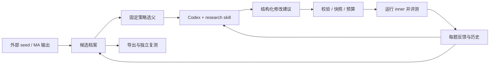

# 当前实现与下一阶段方案

更新：2026-10-14。当前开发版 0.2.0.dev0 已实现有界 beam search；v0.1.0 冻结交付保持原样。

## 目标与职责

AutoR 的交付物是一个固定 outer，用评测证据对外部提供的 inner harness 做版本化探索。当前以工程闭环为验收重点，不承诺优化收益。PPT 仅是最初的场景示例，不属于当前产品边界。

| 角色 | 职责 | 当前边界 |
|---|---|---|
| MA | 创建初始 inner | 作为 seed 输入，其他关系未定义 |
| Outer proposer | 读取父代和评测证据，输出 diagnosis、hypothesis、edits | Codex + autor-research skill；只读，不负责打分与晋升 |
| Outer controller | 选父、校验与应用修改、预算、评测调度、归档、晋升 | 固定 Python 程序，实验内不自修改 |
| Inner | 执行具体任务并产出交付物 | 当前真实预设为 Codex，唯一可变文件为 prompt.md |
| Evaluator | 运行 inner、测量每题结果并返回证据 | 本地 HumanEval、Harbor adapter 或未来 BOS command wrapper |

## 已实现：一次循环如何运行

1. 导入 seed，固定模型、CLI/任务版本、文件白名单、评测器和预算，保存源码与快照摘要。
2. 测量 baseline。完整的零分也是有效测量；基础设施失败单独记录。
3. 从候选档案选择父代，将父代、逐题结果和历史交给 proposer。
4. Proposer 返回诊断、假设和整文件替换。控制器拒绝越界路径、重复候选、无改动、过大文件、必需指令丢失等情况。
5. 创建完整子代快照，调用 evaluator，核对任务覆盖、内容摘要和所要求的提示生效回执。
6. 计算父子逐题变化及总分；只有严格更高才替换 best，同分或低分仍留档。
7. 在次数或累计调用时间预算内继续，停止时生成 findings.md。已评测候选可独立导出。

## 代码定位

| 模块 | 作用 |
|---|---|
| [cli.py](../autor/cli.py) | init、run、status、doctor、export 等命令 |
| [engine.py](../autor/engine.py) | 循环、提案校验、候选状态和晋升 |
| [search.py](../autor/search.py) | 三种选父策略、beam 分代筛选与档案重建 |
| [adapters.py](../autor/adapters.py) | Codex 提案、demo / command / Harbor 评测协议 |
| [storage.py](../autor/storage.py) / [config.py](../autor/config.py) | 文件摘要、原子写入、锁、固定契约 |
| [humaneval.py](../autor/humaneval.py) | 固定任务下载、真实 inner 调用、本地受限 Python 评分和 trial 复用 |
| [bundles.py](../autor/bundles.py) | 可搬迁导出、完整性校验、独立复测 |
| [report.py](../autor/report.py) | 从状态派生可读报告 |
| [research skill](../autor/skills/autor-research/SKILL.md) | proposer 的研究约束和输出要求 |

## 已实现：搜索与状态

`hill_climb` 始终选择当前最高平均分候选。`branching` 在已评测档案中按深度、孩子尝试次数和分数选父，优先每个父代展开两个孩子；低分候选仍可繁殖。这两种策略保留 v0.1 行为。新增的 `beam` 也串行运行，规则如下：

1. Seed 测量后成为初始 frontier；每个父代默认有两个孩子尝试名额，轮流分配。
2. 一代的所有名额完成后，按均分降序、候选 ID 升序保留前两个孩子。只对本代有效测量的孩子排名，不把祖先混入。
3. 失败、拒绝与不确定中断占用名额，不给伪造分数；一代全失败时以 `search_exhausted` 停止。
4. 低于父代的孩子也可入选；历史 best 单独记录，只有严格更高才晋升。淘汰不删除快照，也不阻止导出已评测候选。
5. 预算耗尽或 `--steps` 停在半代时，保留未完成状态，不提前筛选。恢复从候选档案推导轮次与下一个父代，不维护另一套权威队列。

`search.beam_width` 和 `search.children_per_parent` 默认均为 2，允许整数 1–8，初始化时冻结。调用预算独立设置；宽度 2、每父代 2 次尝试、6 个新候选可完成两代（2＋4）。`run.json.search`、`status` 和 `findings.md` 展示分代结果；该 search 字段是派生视图，候选档案才是依据。

候选状态为 `proposing → ready → evaluating → evaluated`。无效提案是 `rejected`，运行失败为 `error`，结果不确定的中断为 `interrupted`。

调用前预留预算并落盘；失败也消耗次数。恢复只接纳确定落盘的完整结果，不自动重放不确定的收费调用。`--steps` 限制本次 CLI 会话新增提案数，不增加总预算。一次实验仅允许一个写入进程。

`run.json` 保存配置、摘要、事件、候选、parents、得分和 best；候选目录保存 harness、proposal、diff、evaluation 与原始日志。`parents` 使用列表为后续合并预留结构，当前每个子代只有一个父代。

## 已实现：测量和导出边界

- 总分统一为固定 task × attempt 集合的平均分，不信任外部另报的总分。
- 任务缺失、重复、非有限分数、任务摘要变化会阻止比较和晋升。
- 提示回执证明候选文本进入请求，不证明某条修改导致了得分变化。
- 本地 HumanEval 使用原始测试、每题一次取样；不报告完整 pass@k，也无独立 held-out 结论。
- 运行版本、固定任务和预算可追溯；远端模型权重与生成结果不保证逐字可复现。
- 导出包含 inner 快照和 provenance。HumanEval 导出还包含固定数据和许可证；run-export 用接收环境重新解析执行路径。
- 普通 command 后端依赖外部程序，不自动成为自包含导出。Harbor 仍需要 Docker 和认证。

v0.1 已完成真实失败反馈和同机新 venv 导出验收，详见 [验收摘要](evidence/v0.1.0.json)。人为 scaffold-only seed 的修复是链路测试，不是研究效果证明。

## 下一阶段：先建立 Terminal-Bench 实验场景

搜索机制已先行扩展；真实实验仍须先验证任务和评测信号。总共预留 6 道任务，其中 4 道用于搜索，2 道只用于最终验证。

搜索任务固定为：

| 任务 | 覆盖的能力 | baseline 后重点检查的失败类型 |
|---|---|---|
| fix-git | Git 状态与变更恢复 | 历史定位、恢复目标、验证遗漏 |
| log-summary-date-ranges | 日志聚合与日期处理 | 日期边界、计数与输出格式 |
| nginx-request-logging | 服务配置与启动验证 | 配置位置、依赖、服务状态 |
| cancel-async-tasks | Python 异步控制 | 并发上限、取消传播和清理 |

这些是预期覆盖的类型，不是已观察到的失败。任务定义与提交来自 [Terminal-Bench 2.0](https://github.com/harbor-framework/terminal-bench-2/tree/69671fbaac6d67a7ef0dfec016cc38a64ef7a77c)；没有读取参考解或评分测试来设计提示。

已实现 [baseline pilot 脚本](../scripts/terminal_bench_pilot.py)：四道任务显式固定到提交，串行单次采样，无重试、不调用 proposer。inner 上限每题 180 秒，整体外部运行上限 1200 秒；这是受限预算的 pilot，不是官方排行榜设置。任务镜像目前沿用上游标签，真实启动时还需要记录镜像 digest、架构及实际 CLI 版本。

进入 inner 比较前的门槛：Docker/认证与模型可用；四题全部有有效测量；至少存在可分析的任务失败。超时、镜像构建或认证错误不能冒充零分。如果全通过，记录原结果并重新设计任务批次，不能人为破坏 seed 以制造“真实失败”。第一轮只比较 baseline 和最多两个子代；确认测量稳定后再用 beam 扩到最多六个新候选。

两道保留任务已在本地单独预选，并对带随机盐的清单生成承诺摘要。公开配置只有摘要和数量。它们目前尚未评测；本地目录分开存储只是准备状态，**不是已完成的隔离**。正式搜索前，应把清单及任务交给 outer 无法访问的独立评测端：不挂载到 outer、不写入 prompt/skill/evidence/history、不让搜索日志引用它们。还需在任何 outer 启动前验证该访问边界。

搜索结束时先冻结候选摘要和选择理由，再在保留任务上同时测 baseline 与最终候选。结果只用于最终报告，不用于再选父、继续提案或在多个候选中择优。更改选择后要新建实验；2 道任务只能提供初步检查，不能支持显著性或广泛泛化结论。当前 pilot 只实现 baseline，未实现该独立评测服务或搜索冻结门禁。

现阶段状态：配置与兼容性测试已通过；本机无 Docker，尚无 Terminal-Bench 实测成绩。模型服务与镜像可运行性也尚未通过真实容器验证。

## 本轮验证与后续范围

[可复现合成对照脚本](../scripts/search_smoke.py) 使用实际控制器和文件快照，替换 proposer/evaluator 为明确的脚本夹具。三种策略采用相同 seed、评分函数、6 次提案、7 次评测和 60 秒调用时间上限，都在第一次提案后退出再恢复。评分函数特意包含“先低分、后高分”的分支，用来检验探索机制。

| 策略 | 合成最高分 | 观测 |
|---|---|---|
| hill_climb | 0.74 | 持续展开当前最佳，未访问低分兄弟分支 |
| branching | 1.00 | 按层访问两个分支 |
| beam | 1.00 | 两代完成；保留 c0006/c0004，淘汰 c0005/c0003 |

这些分数由脚本指定，没有模型调用、真实失败或优化效果结论。六次提案下 branching 和 beam 访问了相同候选树；此对照不能说明 beam 优于 branching。测试另行推进到第三代，核验被淘汰候选不再选父。详见 [当前证据](evidence/search-expansion.json)。

尚未实现：独立保留任务评测服务与搜索冻结门禁、显式重复采样（不覆盖首次成绩）、真实任务上的同预算策略比较。单次采样可能误淘汰候选，当前 beam 没有统计确认或不确定性估计。

本轮保持 prompt 的可修改范围。以后开放工具或工作流代码时，再增加构建/导入检查和执行隔离。MCTS、多父代合并、异步并行与 outer 自修改继续后置。

## Raven 参考的具体取舍

参考 [Raven 的编排设计](https://github.com/EverMind-AI/Raven/blob/ee969dbc41a4b00978b4430aae9590a5ebfba010/evolver/orchestrator/DESIGN.md)：模型负责诊断/设计，确定性程序负责推进与计算；保留候选账本和逐题变化。AutoR 已采用这些组织原则，没有依赖 Raven 代码。

Raven 的筛选/确认分层提醒我们区分探索成绩和后续验证。本轮 beam 与预算控制是本项目的实现，并非 Raven 的现成代码；当前也未实现其显著性门槛或完整归因机制。
