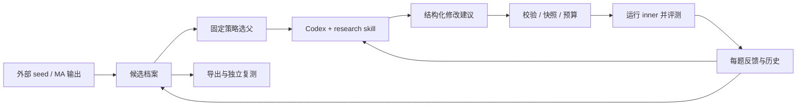

# 当前实现与下一阶段方案

更新：2026-10-15。当前开发版 0.2.0.dev1 已实现有界 beam search；近期优先 BOS 接入。新增预检工具不改变核心版本或冻结实验的源码摘要；v0.1.0 冻结交付保持原样。

## 目标与职责

AutoR 的交付物是一个固定 outer，用评测证据对外部提供的 inner harness 做版本化探索。当前以工程闭环为验收重点，不承诺优化收益。PPT 仅是最初的场景示例，不属于当前产品边界。

| 角色 | 职责 | 当前边界 |
|---|---|---|
| MA | 创建初始 inner | 作为 seed 输入，其他关系未定义 |
| Outer proposer | 读取父代和评测证据，输出 diagnosis、hypothesis、edits | Codex + autor-research skill；只读，不负责打分与晋升 |
| Outer controller | 选父、校验与应用修改、预算、评测调度、归档、晋升 | 固定 Python 程序，实验内不自修改 |
| Inner | 执行具体任务并产出交付物 | 当前真实预设为 Codex，唯一可变文件为 prompt.md |
| Evaluator | 运行 inner、测量每题结果并返回证据 | 本地 HumanEval、Harbor adapter；BOS 已有只读预检，评测 wrapper 待接通 |

## 已实现：一次循环如何运行

1. 导入 seed，固定模型、CLI/任务版本、文件白名单、评测器和预算，保存源码与快照摘要。
2. 测量 baseline。完整的零分也是有效测量；基础设施失败单独记录。
3. 从候选档案选择父代，将父代、逐题结果和历史交给 proposer。
4. Proposer 返回诊断、假设和整文件替换。控制器拒绝越界路径、重复候选、无改动、过大文件、必需指令丢失等情况。
5. 创建完整子代快照，调用 evaluator，核对任务覆盖、内容摘要和所要求的提示生效回执。
6. 计算父子逐题变化及总分；只有严格更高才替换 best，同分或低分仍留档。
7. 在次数或累计调用时间预算内继续，停止时生成 findings.md。已评测候选可独立导出。

## 代码定位

| 模块 | 作用 |
|---|---|
| [cli.py](../autor/cli.py) | init、run、status、doctor、export 等命令 |
| [engine.py](../autor/engine.py) | 循环、提案校验、候选状态和晋升 |
| [permissions.py](../autor/permissions.py) | proposer 命令的工作目录读权限、关闭命令网络及启动前 canary 检查 |
| [search.py](../autor/search.py) | 三种选父策略、beam 分代筛选与档案重建 |
| [adapters.py](../autor/adapters.py) | Codex 提案、demo / command / Harbor 评测协议 |
| [storage.py](../autor/storage.py) / [config.py](../autor/config.py) | 文件摘要、原子写入、锁、固定契约 |
| [humaneval.py](../autor/humaneval.py) | 固定任务下载、真实 inner 调用、本地受限 Python 评分和 trial 复用 |
| [bundles.py](../autor/bundles.py) | 可搬迁导出、完整性校验、独立复测 |
| [report.py](../autor/report.py) | 从状态派生可读报告 |
| [research skill](../autor/skills/autor-research/SKILL.md) | proposer 的研究约束和输出要求 |

## 已实现：搜索与状态

`hill_climb` 始终选择当前最高平均分候选。`branching` 在已评测档案中按深度、孩子尝试次数和分数选父，优先每个父代展开两个孩子；低分候选仍可繁殖。这两种策略保留 v0.1 行为。新增的 `beam` 也串行运行，规则如下：

1. Seed 测量后成为初始 frontier；每个父代默认有两个孩子尝试名额，轮流分配。
2. 一代的所有名额完成后，按均分降序、候选 ID 升序保留前两个孩子。只对本代有效测量的孩子排名，不把祖先混入。
3. 失败、拒绝与不确定中断占用名额，不给伪造分数；一代全失败时以 `search_exhausted` 停止。
4. 低于父代的孩子也可入选；历史 best 单独记录，只有严格更高才晋升。淘汰不删除快照，也不阻止导出已评测候选。
5. 预算耗尽或 `--steps` 停在半代时，保留未完成状态，不提前筛选。恢复从候选档案推导轮次与下一个父代，不维护另一套权威队列。

`search.beam_width` 和 `search.children_per_parent` 默认均为 2，允许整数 1–8，初始化时冻结。调用预算独立设置；宽度 2、每父代 2 次尝试、6 个新候选可完成两代（2＋4）。`run.json.search`、`status` 和 `findings.md` 展示分代结果；该 search 字段是派生视图，候选档案才是依据。

候选状态为 `proposing → ready → evaluating → evaluated`。无效提案是 `rejected`，运行失败为 `error`，结果不确定的中断为 `interrupted`。

调用前预留预算并落盘；失败也消耗次数。恢复只接纳确定落盘的完整结果，不自动重放不确定的收费调用。`--steps` 限制本次 CLI 会话新增提案数，不增加总预算。一次实验仅允许一个写入进程。

`run.json` 保存配置、摘要、事件、候选、parents、得分和 best；候选目录保存 harness、proposal、diff、evaluation 与原始日志。`parents` 使用列表为后续合并预留结构，当前每个子代只有一个父代。

## 已实现：proposer 的输入访问范围

Codex 提案不再使用可广泛读取宿主文件的旧 `--sandbox read-only` 预设，而使用固定 permission profile：只读当前提案工作目录、系统最小运行库，以及 macOS 的 CommandLineTools。控制器在该目录暂存父代、搜索反馈、输出 schema 和请求文本。命令网络关闭，web search 关闭，自动 AGENTS.md 文档注入关闭，继续忽略用户 config 并禁止审批升级。

每次模型调用前，控制器用相同权限执行 canary：工作输入可读；目录外文件、指向目录外的符号链接、写入和连接已监听的本地端口都必须失败。CLI 或平台不支持时直接停止，不退回宽松权限。探测不调用模型，时间计入提案上限；结果保存在 `proposal/isolation.json`。当前已在 macOS、Codex CLI 0.153.4 验证，并完成一次真实模型 canary 调用；Linux 尚未实机验收。

这是 **proposer 本地命令的文件访问边界**，不是独立评测服务，也不限制受信任控制器、模型/认证服务流量或另行启用的 MCP、连接器、浏览器。保留任务及结果不能被控制器写入暂存输入；正式使用其他工具面前仍须验证各自的访问权限。候选冻结和独立保留集测量仍需后续实现。依据：[Codex 官方权限文档](https://learn.chatgpt.com/docs/permissions)。

## 已实现：测量和导出边界

- 总分统一为固定 task × attempt 集合的平均分，不信任外部另报的总分。
- 任务缺失、重复、非有限分数、任务摘要变化会阻止比较和晋升。
- 提示回执证明候选文本进入请求，不证明某条修改导致了得分变化。
- 本地 HumanEval 使用原始测试、每题一次取样；不报告完整 pass@k，也无独立 held-out 结论。
- 运行版本、固定任务和预算可追溯；远端模型权重与生成结果不保证逐字可复现。
- 导出包含 inner 快照和 provenance。HumanEval 导出还包含固定数据和许可证；run-export 用接收环境重新解析执行路径。
- 普通 command 后端依赖外部程序，不自动成为自包含导出。Harbor 仍需要 Docker 和认证。

v0.1 已完成真实失败反馈和同机新 venv 导出验收，详见 [验收摘要](evidence/v0.1.0.json)。人为 scaffold-only seed 的修复是链路测试，不是研究效果证明。

## 下一阶段：BOS 接入、搜索质量与工程化

2026-10-15 确认两条发展方向：先确保 AutoR 能使用 BOS 运行和测量 inner；再增强搜索和工程实现。交付重点仍是可靠的固定 outer，不以短期分数提升作为接入验收条件。

### 1. 先完成 BOS 真实闭环

第一步采用 **本地 AutoR outer → BOS 远端 inner 评测**。把 outer 作为长期服务部署，是后续工程化问题；当前提供的 BOS skills 描述的是评测任务执行，没有证明 BOS 能直接托管整个研究控制器。

已读取用户提供的主说明、五个 skill 的入口及 BOS 相关参考，核对独立 ZIP 与合集对应文件一致。`bos-exec` 提供资源发现、Task 上传/导入、Run 提交/等待/取消和证据下载。其他 skill 分别覆盖评测设计、Task 构建、评分与展示。其接口资料更新于 2026-10-14，实际字段仍以目标服务 OpenAPI 为准。

| AutoR 对象 | BOS 对应关系 | 待验证条件 |
|---|---|---|
| 固定 benchmark 任务 | READY/ACTIVE CaseVersion | 内容身份、评分规则、镜像与搜索集固定 |
| inner 运行时和模型 | HarnessRelease＋RunProfile | 不把平台默认 MA Harness 当作现有 Codex inner 的等价替代 |
| 候选文件快照 | 新 AgentRelease，或部署支持的组件/组合 Release | 候选打包结构、上传与发布合同；每次修改产生对应内容身份 |
| 一次候选评测 | EvaluationRun 与全部 Trial | 幂等提交、终态清理、逐题有效性、分数和反馈 |
| 生效与追溯 | resolved_identity、制品 digest、运行时证据 | 证明本次执行使用指定候选，而非固定平台默认包 |

这里 BOS 的 `harness_type=ma` 是平台的执行类型；不能据名称将其等同于 AutoR 设计中的 meta agent 角色。

当前附件说明了消费已有行为包，未定义将 AutoR 的 Codex `prompt.md` 发布为兼容包的具体合同。连通后先读取部署资源与 OpenAPI，再确定保持 Codex inner 的接法；如果暂时只能运行平台已有 MA 包，应单独标记为平台 smoke test。不能把该结果当作当前 inner 候选的测量。

接入按以下小步验收：

1. **资源发现**：健康检查、版本、OpenAPI、Profile/Harness/AgentRelease 身份及存储访问可用。显式选定版本，不暗选最新包。已有只读脚本和本地 HTTP 测试；真实入口连接超时，尚未完成此项。
2. **一次平台 full 评测**：优先复用一项已有、短时、程序评分的搜索任务，串行、单次采样，保存完整 Run/Trial 和产物。需要诊断时才增加 env/install；oracle 不算真实 inner 调用。模型复用已选择 Profile，凭据留在平台。
3. **一次 AutoR 闭环**：固定同一任务、模型、运行时和评分器，发布 baseline 与一个真实修改的子代，最多两次 full 测量、一次提案。先按总计约 20 分钟的上限设计；具体超时须与平台合同核对。验收候选身份不同、实际生效、反馈回到 outer、错误分类和账本对应正确；不要求子代提分。
4. **接回 command evaluator**：wrapper 负责 publish/submit/poll/collect/cancel，返回现有逐题 JSON。固定 CaseVersion 内容身份并核对完整 task×attempt 覆盖。有效零分保留；无效 Trial、缺分或清理失败不补零。

提交前落盘 payload、幂等 key 和候选映射；未知提交结果用同一 key/payload 查询或恢复，不能创建另一个收费 Run。等待超时不代表远端已停止；记录 Run 引用，取消后等待清理终态。当前同步子进程超时会杀进程，因此正式 wrapper 还需预留取消时间并支持外部恢复对账，不能仅靠本地进程退出保证远端预算。

本轮结果见 [BOS 接入凭证](evidence/bos-integration.json)。预检读取部署配置，既不是可运行的 BOS evaluator，也不证明候选发布能力。内网地址、原始附件、服务响应和潜在私有任务清单只保留本地，公开仓库保存脱敏摘要。

### 2. 把搜索做得更可靠，再增加算法

保留现有 hill_climb、branching、beam 作为对照。先解决评测信号和选择质量：选择有真实可分析失败的少量任务；增加显式复测，保存每次独立样本而不覆盖首轮；将粗筛与确认测量分开，并把确认预算计入总预算。搜索结束先冻结候选，再由隔离的保留集验证，不把验证结果回流搜索。

随后引入统一策略接口，输出选父决定、扩展名额、预算分配与停止理由。在相同模型、任务和总评测预算下，比较现有 beam 与预算自适应筛选；只有观察到深层探索不足时，再加入 UCB/MCTS 等策略。多样性可以依据变更类型和逐题表现，不能只奖励不同措辞。指标同时记录任务分、无效运行率、耗时、调用量和单位预算收益；小样本结果不作统计显著性承诺。

这一阶段先保持 prompt 的修改范围，避免搜索算法、模型、可修改代码和评分规则同时变化。开放 skill、工具代码或工作流时，另外增加构建、依赖与隔离验收。

### 3. 把实现逐步工程化

Codex＋skill 可继续作为第一个 proposer 实现；将其放在可替换接口后，研究约束留在 skill，调度与一致性由程序负责。先建立模块边界，再根据并发需求选择服务化范围。

| 顺序 | 工程扩展 | 验收条件 |
|---|---|---|
| A | Proposer / SearchPolicy / CandidatePublisher / Evaluator 接口；候选与执行身份独立建模 | 同一控制器可切换本地与 BOS 后端；身份不能混用 |
| B | 持久化执行账本、幂等提交、恢复对账、取消与超时状态 | 控制器重启后找回已有 Run，不重复计费、不丢失失败证据 |
| C | 有界 worker 并发、预算预留、租约和配额 | 并行运行不超发预算，同一结果不重复晋升 |
| D | 结构化事件、指标、制品存储、可查询的实验与血缘 | 每个分数能追到候选、任务、模型、运行和原始证据 |

目前仍是单进程、文件账本、串行调用；以上不是已实现能力。先完成 A/B 和 BOS 的短闭环，再决定是否需要数据库、队列或独立控制服务，避免一次性重写整个 outer。

## Terminal-Bench 已有实验与后续门槛

搜索机制已先行扩展；真实实验仍须先验证任务和评测信号。总共预留 6 道任务，其中 4 道用于搜索，2 道只用于最终验证。

搜索任务固定为：

| 任务 | 覆盖的能力 | baseline 后重点检查的失败类型 |
|---|---|---|
| fix-git | Git 状态与变更恢复 | 历史定位、恢复目标、验证遗漏 |
| log-summary-date-ranges | 日志聚合与日期处理 | 日期边界、计数与输出格式 |
| nginx-request-logging | 服务配置与启动验证 | 配置位置、依赖、服务状态 |
| cancel-async-tasks | Python 异步控制 | 并发上限、取消传播和清理 |

这些是预期覆盖的类型，不是已观察到的失败。任务定义与提交来自 [Terminal-Bench 2.0](https://github.com/harbor-framework/terminal-bench-2/tree/69671fbaac6d67a7ef0dfec016cc38a64ef7a77c)；没有读取参考解或评分测试来设计提示。

已实现 [baseline pilot 脚本](../scripts/terminal_bench_pilot.py)：四道任务显式固定到提交，串行单次采样，无重试、不调用 proposer。inner 上限每题 180 秒，整体外部运行上限 1200 秒；这是受限预算的 pilot，不是官方排行榜设置。任务镜像目前沿用上游标签，真实启动时还需要记录镜像 digest、架构及实际 CLI 版本。

进入 inner 比较前的门槛：Docker/认证与模型可用；四题全部有有效测量；至少存在可分析的任务失败。超时、镜像构建或认证错误不能冒充零分。如果全通过，记录原结果并重新设计任务批次，不能人为破坏 seed 以制造“真实失败”。第一轮只比较 baseline 和最多两个子代；确认测量稳定后再用 beam 扩到最多六个新候选。

两道保留任务已在本地单独预选，并对带随机盐的清单生成承诺摘要。公开配置只有摘要和数量。它们目前尚未评测；本地目录分开存储本身不构成隔离；本轮另外实现了上文的 proposer 命令访问限制，并验证评测 VM 不挂载清单。独立保留集评测服务仍未实现。正式搜索前，应把清单及任务交给 outer 无法访问的独立评测端：不挂载到 outer、不写入 prompt/skill/evidence/history、不让搜索日志引用它们。还需在任何 outer 启动前验证该访问边界。

搜索结束时先冻结候选摘要和选择理由，再在保留任务上同时测 baseline 与最终候选。结果只用于最终报告，不用于再选父、继续提案或在多个候选中择优。更改选择后要新建实验；2 道任务只能提供初步检查，不能支持显著性或广泛泛化结论。当前 pilot 只实现 baseline，未实现该独立评测服务或搜索冻结门禁。

本机已接通 Lima/Docker，四题真实 baseline 完成：`fix-git`、`log-summary-date-ranges`、`nginx-request-logging`、`cancel-async-tasks` 均为 1.0。完整测量约 796.5 秒，四次 inner 运行、零次 proposer 调用，未评测保留任务。CLI 实际版本为 0.153.4，模型为 gpt-6-astra。

运行环境为 macOS ARM 上的 VZ＋Rosetta，原始 amd64 镜像 digest 已记录；预置固定 Node 运行时，并限制 APT 下载超时。最初的依赖安装超时及 PATH 传播问题已单独留档，没有伪造零分或重放模型请求。详见 [当前凭证](evidence/terminal-bench-pilot.json)。

本批暂未观察到自然任务失败，不能用满分 baseline 声称 harness 已优化。恢复该实验场景时应先调整搜索任务；获得可分析的失败并完成候选冻结/验证流程后，再比较少量子代。两道保留任务继续独立，不能根据其成绩来挑搜索题或修改 harness。

## 本轮验证与后续范围

[可复现合成对照脚本](../scripts/search_smoke.py) 使用实际控制器和文件快照，替换 proposer/evaluator 为明确的脚本夹具。三种策略采用相同 seed、评分函数、6 次提案、7 次评测和 60 秒调用时间上限，都在第一次提案后退出再恢复。评分函数特意包含“先低分、后高分”的分支，用来检验探索机制。

| 策略 | 合成最高分 | 观测 |
|---|---|---|
| hill_climb | 0.74 | 持续展开当前最佳，未访问低分兄弟分支 |
| branching | 1.00 | 按层访问两个分支 |
| beam | 1.00 | 两代完成；保留 c0006/c0004，淘汰 c0005/c0003 |

这些分数由脚本指定，没有模型调用、真实失败或优化效果结论。六次提案下 branching 和 beam 访问了相同候选树；此对照不能说明 beam 优于 branching。测试另行推进到第三代，核验被淘汰候选不再选父。详见 [当前证据](evidence/search-expansion.json)。

尚未实现：独立保留任务评测服务与搜索冻结门禁、显式重复采样（不覆盖首次成绩）、真实任务上的同预算策略比较。单次采样可能误淘汰候选，当前 beam 没有统计确认或不确定性估计。

本轮保持 prompt 的可修改范围。以后开放工具或工作流代码时，再增加构建/导入检查和执行隔离。MCTS、多父代合并、异步并行与 outer 自修改继续后置。

## Raven 参考的具体取舍

参考 [Raven 的编排设计](https://github.com/EverMind-AI/Raven/blob/ee969dbc41a4b00978b4430aae9590a5ebfba010/evolver/orchestrator/DESIGN.md)：模型负责诊断/设计，确定性程序负责推进与计算；保留候选账本和逐题变化。AutoR 已采用这些组织原则，没有依赖 Raven 代码。

Raven 的筛选/确认分层提醒我们区分探索成绩和后续验证。本轮 beam 与预算控制是本项目的实现，并非 Raven 的现成代码；当前也未实现其显著性门槛或完整归因机制。
